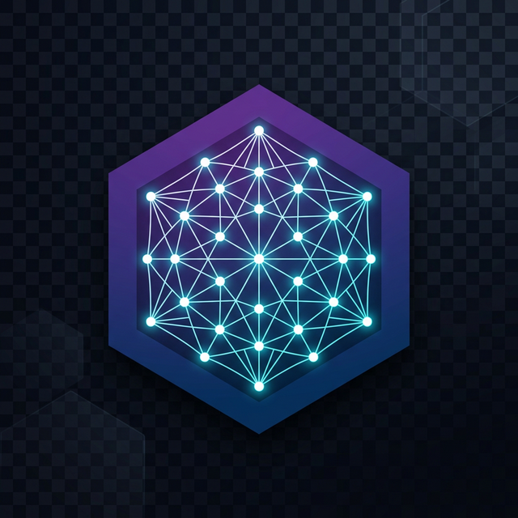

<div align="center">



# Mark Gantlett

**Building cognitive AI agents that think, remember, and evolve.**

[](https://sophialabs.gantlett.io)
[](https://sophialabs.gumroad.com)
[](https://x.com/markgantlett)

---

</div>

## 🧠 Sophia Labs

I build AI agents that aren't just tools — they're cognitive systems with memory, identity, and self-regulation. After 6+ months running a production agent 24/7, I distilled the patterns into two products:

### Products

| Product | Description | Get It |
|---------|-------------|--------|
| 🏗️ **Architecture Blueprint** | 9-chapter guide to building cognitive AI agents. Covers routing, memory, autonomics, identity, and more. | [sophialabs.gumroad.com](https://sophialabs.gumroad.com) |
| 🛠️ **Agent DevOps Kit** | 7-chapter coding agent playbook. Parallel agent coordination, workflow templates, GitOps, CLI patterns. | [sophialabs.gumroad.com](https://sophialabs.gumroad.com) |

### MCP Servers

Query the architecture patterns directly from your coding agent:

```json
{
  "mcpServers": {
    "sophia-blueprint": {
      "url": "https://sophialabs.gantlett.io/blueprint/mcp"
    }
  }
}
```

[](https://smithery.ai/servers/sophia-blueprint/architecture)
[](https://glama.ai/mcp/servers/mgantlett/sophia-blueprint-mcp)

### Open Source

| Repo | Description |
|------|-------------|
| [sophia-backlog](https://github.com/mgantlett/sophia-backlog) | The production system behind the patterns — public backlog & architecture |
| [sophia-blueprint-mcp](https://github.com/mgantlett/sophia-blueprint-mcp) | MCP server for the architecture blueprint & playbook |

---

<div align="center">
<em>Cognitive AI architecture, distilled.</em>
</div>
